<p align="center">
  
</p>

<p align="center">
  
</p>

<p align="center">
  &nbsp;&nbsp;&nbsp;&nbsp;&nbsp;&nbsp;&nbsp;&nbsp;&nbsp;&nbsp;
</p>

<p align="center">
  <a href="https://www.linkedin.com/in/kjucaitis/"></a>
  <a href="https://www.thedataschool.co.uk/blog/kristupas-justas-jucaitis/"></a>
  <a href="https://public.tableau.com/app/profile/kristupas.jucaitis/vizzes"></a>
  <a href="mailto:kristupas.jucaitis@theinformationlab.co.uk"></a>
</p>

<p align="center">
  
</p>

<h2></h2>

<table align="center">
  <tr>
    <td align="center">
      
    </td>
    <td>
      <table>
        <tr><td><b>NAME</b></td><td>Kristupas (Kris)</td></tr>
        <tr><td><b>CLASS</b></td><td>Data Engineer</td></tr>
        <tr><td><b>WORKS AT</b></td><td>The Information Lab</td></tr>
        <tr><td><b>TOWN</b></td><td>London</td></tr>
        <tr><td><b>ORIGIN</b></td><td>Lithuania</td></tr>
        <tr><td><b>HOBBIES</b></td><td>Cooking · travel · gaming</td></tr>
        <tr><td><b>SIDE QUEST</b></td><td>Exploring Azeroth</td></tr>
        <tr><td><b>ALL-TIME FAVE</b></td><td>Oddish </td></tr>
      </table>
    </td>
    <td align="center">
       <br/>
        <br/>
      <sub><b>PARTY</b></sub>
    </td>
  </tr>
</table>

<h2></h2>

<p align="center">
  &nbsp;<b>➜</b>&nbsp;&nbsp;<b>➜</b>&nbsp;&nbsp;<b>➜</b>&nbsp;<b>?</b>
</p>

```mermaid
%%{init: {'theme':'base','themeVariables':{'lineColor':'#FFCB05','fontFamily':'monospace'}}}%%
flowchart LR
    V[Bioveterinary<br/>Sciences<br/>@ RVC] --> B[The Data<br/>School]
    A[Retail &<br/>hospitality] --> B
    B --> C[Data Analyst<br/>Tableau<br/>Alteryx<br/>Power BI]
    C --> D[Data Engineer<br/>Python<br/>Snowflake<br/>dbt]
    D --> E((???))
    classDef grey fill:#2B2F4A,stroke:#9AA0B8,color:#FFFFFF
    classDef blue fill:#1B1F3B,stroke:#3D7DCA,color:#FFFFFF
    classDef yellow fill:#1B1F3B,stroke:#FFCB05,color:#FFCB05
    classDef red fill:#1B1F3B,stroke:#E3350D,color:#FFFFFF
    classDef green fill:#1B1F3B,stroke:#78C850,color:#78C850
    classDef pink fill:#1B1F3B,stroke:#EE99AC,color:#FFFFFF
    class V pink
    class A grey
    class B blue
    class C red
    class D yellow
    class E green
```

> *What? KRIS is evolving!* Studied Bioveterinary Sciences at the **Royal Veterinary College** while working in retail and hospitality, then swapped animals for data. Along the way: consulting placements at **Guy's & St Thomas' Foundation** (Tableau dashboards for the *State of Urban Health* report) and **Voyage Care** (migrated ~150 users to Alteryx One, rebuilt referrals reporting in Power BI on a new Synapse/ADF pipeline).

<h2></h2>

| No. | Project | What it does | Type |
|-----|---------|--------------|------|
| `001` | [**pokeapi-pipeline**](https://github.com/kjucaitis/pokeapi-pipeline) | Pulls every Pokémon from PokeAPI, sprites and artwork included, then transforms it in DuckDB. Powers [The People's Pokémon](https://public.tableau.com/app/profile/kristupas.jucaitis/viz/ThePeoplesPokmon/Home) dashboard on Tableau Public | Python · DuckDB · SQL · Tableau |
| `002` | [**tfl-bikepoint-api**](https://github.com/kjucaitis/tfl-bikepoint-api) | Pulls TfL BikePoint data hourly to track how long broken docks take to get fixed, per station | Python · S3 · Snowflake · dbt · Kestra |
| `003` | [**amplitude-api**](https://github.com/kjucaitis/amplitude-api) | Daily export of website event data to find out what people actually click | Python · S3 · Snowflake · dbt |

<h2> </h2>

**KEY ITEMS** · engineering
<p>
  
  
  
  
  
  
  
  
  
</p>

**TMs** · analytics & viz
<p>
  
  
  
  
  
</p>

<h2> </h2>

```yaml
building:  SQL replacements for Tableau Prep flows
writing:   Git for data people (a blog post, eventually)
learning:  more dbt, more Snowflake, fewer manual refreshes
playing:   WoW: Enhancement + Restoration shaman, Arcane mage
```

<h2> </h2>

<p align="center">
  
  
</p>

<p align="center">
  
</p>

<p align="center">
  
</p>

<p align="center">
   
</p>
