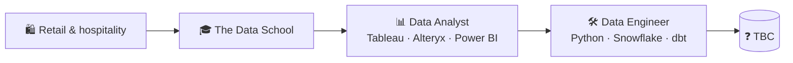

<!-- Header -->
<p align="center">
  
</p>

<p align="center">
  <a href="https://git.io/typing-svg">
    
  </a>
</p>

<p align="center">
  <a href="https://www.linkedin.com/in/kjucaitis/"></a>
  <a href="https://www.thedataschool.co.uk/blog/kristupas-justas-jucaitis/"></a>
  <a href="https://public.tableau.com/app/profile/kristupas.jucaitis/vizzes"></a>
  <a href="mailto:kristupas.jucaitis@theinformationlab.co.uk"></a>
</p>


##  Hi, I'm Kristupas (Kris)

```sql
SELECT *
FROM   people
WHERE  github_handle = 'kjucaitis';
```

| name | role | based_in | from | off_the_clock |
|------|------|----------|------|---------------|
| Kristupas (Kris) | Data Engineer @ The Information Lab | London 🇬🇧 | Lithuania 🇱🇹 | cooking, travel, gaming |

> `1 row returned. 0 nulls. Rare.`

## 🛤️ How I got here



Consulting placements along the way, including **Guy's & St Thomas' Foundation** (Tableau dashboards for the *State of Urban Health* report) and **Voyage Care** (migrated ~150 users to Alteryx One, rebuilt referrals reporting in Power BI on a new Synapse/ADF pipeline).

## 🚧 Featured projects

| Project | What it does | Built with |
|---------|--------------|------------|
| [**pokeapi-pipeline**](https://github.com/kjucaitis/pokeapi-pipeline) | Pulls every Pokémon from PokeAPI, sprites and artwork included, then transforms it in DuckDB. Powers [The People's Pokémon](https://public.tableau.com/app/profile/kristupas.jucaitis/viz/ThePeoplesPokmon/Home) dashboard on Tableau Public | Python · DuckDB · SQL · Tableau |
| [**tfl-bikepoint-api**](https://github.com/kjucaitis/tfl-bikepoint-api) | Pulls TfL BikePoint data hourly to track how long broken docks take to get fixed, per station | Python · S3 · Snowflake · dbt · Kestra |
| [**amplitude-api**](https://github.com/kjucaitis/amplitude-api) | Daily export of website event data to find out what people actually click | Python · S3 · Snowflake · dbt |

## 🧰 Toolbox

**Engineering**
<p>
  
  
  
  
  
  
  
  
  
</p>

**Analytics & viz**
<p>
  
  
  
  
  
</p>

## 📡 Currently

```yaml
building:  SQL replacements for Tableau Prep flows
writing:   Git for data people (a blog post, eventually)
learning:  more dbt, more Snowflake, fewer manual refreshes
playing:   WoW (Enhancement shaman, Arcane mage)
```

## 📈 Activity

<p align="center">
  
  
</p>

<p align="center">
  
</p>

<!-- Footer -->
<p align="center">
  
</p>
